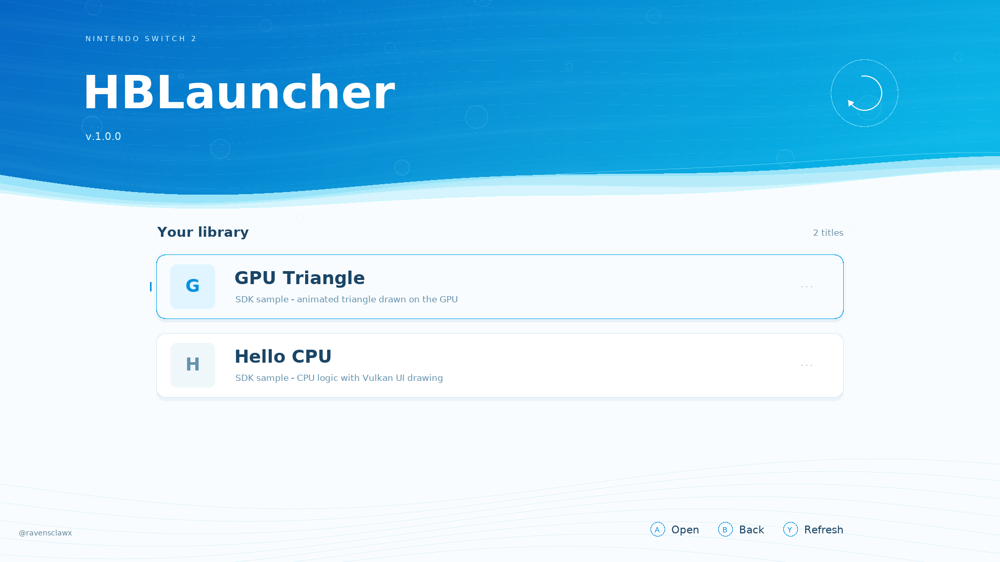

# HBLauncher



A native AArch64 homebrew launcher and app SDK for Nintendo Switch 2, by
**RavensClawX**. The launcher runs inside a SmileBASIC application process
with an externally established, verified 4/4 session. CPU code handles the UI
layout, animation, and input; Vulkan draws the interface.

## Features

- App catalog with controller navigation, animated transitions, and return to launcher.
- Native package loader and a versioned SDK ABI.
- Freestanding runtime with input, touch, timing, heap, logging, and package assets.
- Shared Vulkan display and a small 2D UI library, plus a raw Vulkan example.
- Original Hello CPU and GPU Triangle demo apps.
- Mock console backend and an offline Vulkan preview for development.

Game ports, emulators, commercial assets, media, console keys, and compiled
app payloads are excluded. Build the included demos from source.

## Game ports

These ports are maintained by **@ravensclawx** in separate repositories:

- [Animal Crossing](https://github.com/ravensclawx/AnimalCrossing-HBLauncher) — based on ACGC-PC-Port.
- [Twilight Princess](https://github.com/ravensclawx/TwilightPrincess-HBLauncher) — based on Dusklight.

Set up HBLauncher using [Getting started](docs/GETTING_STARTED.md), then follow
each port's README for build, installation, and file-server instructions.
Both require your own supported game disc image.

## Build

Use Linux with Node.js 18+, Python 3 with Pillow, GCC, the AArch64 GNU
compiler/binutils, glslang, SPIR-V Tools, and DejaVu fonts. The offline tests
also need QEMU user emulation and a Vulkan implementation such as Mesa lavapipe.
On Debian/Ubuntu, the dependency packages are:

```sh
sudo apt install nodejs python3 python3-pil gcc gcc-aarch64-linux-gnu \
  binutils-aarch64-linux-gnu glslang-tools spirv-tools fonts-dejavu-core \
  qemu-user libvulkan1 mesa-vulkan-drivers
```

From the repository root:

```sh
sh tools/build-all.sh
sh tests/run.sh
./hbl-start --mock
```

If Node is installed outside `PATH`, set `HBL_NODE` to its executable path.
The build regenerates the font atlas, shader blobs, and ABI metadata, then
builds the launcher, apps, hardware probe, SDK example, and offline preview.
Generated binaries and local state are ignored by Git.

To render preview frames after building:

```sh
./build/preview/hbl-preview tests/preview/out 6
```

The preview uses a synthetic catalog. Tests default to the lavapipe ICD at
`/usr/share/vulkan/icd.d/lvp_icd.json`; set `VK_ICD_FILENAMES` if your system
uses a different path.

## Console setup

Provide a separate `ns2jb-kurumuz` checkout and establish the required session.
The launcher requires verified 4/4 before mapping native code.

```sh
export HBL_NS2JB=/path/to/ns2jb-kurumuz
./hbl-start --preflight
./hbl-start
```

See [Getting started](docs/GETTING_STARTED.md) and [Recovery](docs/RECOVERY.md)
for session setup and diagnostics. `--spawn --guide` additionally requires the
external controller tooling described there.

| Variable | Purpose |
| --- | --- |
| `HBL_NODE` | Node executable |
| `HBL_NS2JB` | External session runner checkout |
| `HBL_APPS` | Alternate app package directory |
| `HBL_RPC_TARGET` | Console RPC address |
| `HBL_PICO_TOOL` | External controller tool for guided setup |
| `HBL_COMPAT_ROOT` | Optional external legacy compatibility projects |

## Develop an app

```sh
python3 sdk/tools/hbx-new.py apps/my-app "My App"
python3 sdk/tools/hbx-build.py apps/my-app
```

Read the [SDK guide](docs/SDK.md), [SDK reference](sdk/README.md), and
[raw Vulkan example](sdk/examples/raw-vulkan/). The optional
[Linux personality runtime](sdk/linux/README.md) requires a separately
configured musl toolchain and is not built by the default build.

## Source layout

| Directory | Contents |
| --- | --- |
| `launcher/` | Native launcher, navigation, and Vulkan UI |
| `host/` | Session management, package loading, and app lifecycle |
| `sdk/` | ABI headers, runtime, templates, examples, and build tools |
| `apps/` | Original demo source packages |
| `assets/` | Font atlas and font license notice |
| `docs/` | Architecture, SDK, setup, and recovery guides |
| `tests/` | ABI, mock lifecycle, navigation, and rendering checks |
| `tools/` | Asset generators and development utilities |

## Source release

Run `python3 tools/package-release.py` to create
`release/hblauncher-native-source.tar.gz` from the current source tree.
It excludes Git history, build products, local settings, and user app assets,
and checks the included files for private workstation identifiers.
Use this archive for a fresh public repository; the existing local Git history
still contains earlier versions and is not sanitized by deleting working files.

## License

[MIT](LICENSE), copyright RavensClawX and contributors. The font atlas retains
its separate [third-party notice](THIRD_PARTY.md). This independent project is
not affiliated with or endorsed by Nintendo.
